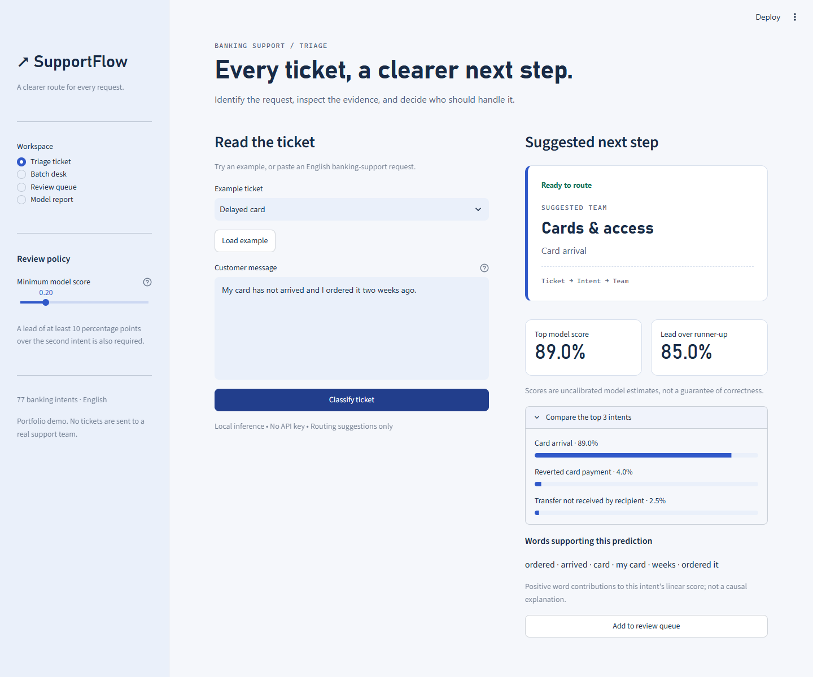
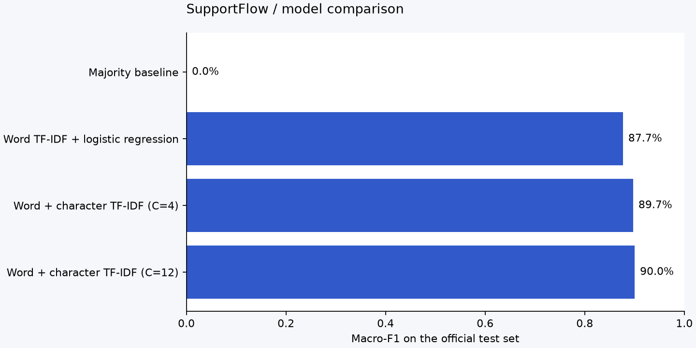
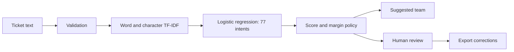

# ↗ SupportFlow

**A support-ticket classifier with measurable results and a human review workflow.**

SupportFlow predicts one of 77 English banking-support intents, suggests a destination
team, explains influential words, and flags uncertain predictions. It runs locally
on a CPU with no API key. The Streamlit app includes individual classification,
batch CSV processing, a correction queue, and an evaluation report.



## Recorded results

On the official **3,080-ticket BANKING77 test set**:

- **90.00% accuracy** and **90.01% macro-F1**.
- Word-only TF-IDF baseline: **87.66% macro-F1**.
- Selected model: word + character TF-IDF with logistic regression (`C=12`).
- Top-three intent accuracy: **97.18%**.
- Default review policy accepts **93.54%** of test tickets, with **93.41% accuracy**
  among accepted tickets. This is selective classification, not overall accuracy.
- Median warm inference: **7.31 ms** per ticket over 100 examples on the training
  machine. This is a local benchmark, not an API latency guarantee.

The model and review threshold were chosen on validation data **before** evaluating
the test labels. The test set was never used to fit the vocabulary or classifier.
See [evaluation JSON](reports/metrics.json), [model card](MODEL_CARD.md), and
[dataset attribution and cleaning policy](DATASET.md).



## Run in VS Code on Windows

Use **Python 3.11** for the tested environment. Open this project folder in VS Code.
The current workspace already has `.venv` and a trained model.

In a new PowerShell terminal:

```powershell
.\.venv\Scripts\python.exe -m streamlit run app.py
```

Open **http://localhost:8501**. Stop the terminal process with `Ctrl+C` when finished.
Alternatively, choose **SupportFlow: run app** in VS Code's Run and Debug menu.
The recommended Python and Python Debugger extensions enable that configuration.

### Fresh checkout

```powershell
py -3.11 -m venv .venv
.\.venv\Scripts\python.exe -m pip install -r requirements-dev.txt
.\.venv\Scripts\python.exe -m streamlit run app.py
```

The checked-in model makes the demo runnable without downloading the training data.
You can also run `powershell -ExecutionPolicy Bypass -File .\run.ps1`; the execution
policy override applies to that process only.

macOS/Linux equivalent:

```bash
python3.11 -m venv .venv
source .venv/bin/activate
pip install -r requirements-dev.txt
streamlit run app.py
```

## Try the project

1. **Triage ticket:** classify the delayed-card example. Inspect alternatives and
   word contributions. Change the review threshold to see when a human is needed.
2. **Review queue:** add a prediction, confirm or correct its intent, and export the
   record. Queue entries exist only in the browser session.
3. **Batch desk:** download the sample CSV, upload it, classify, filter by status, and
   export all results. Limits: 1 MB, 250 rows, and 4,000 characters per message.
4. **Model report:** inspect baselines, the threshold trade-off, per-intent results,
   a full confusion matrix, and the documented limitations.

The CSV must contain a `text` column. Other columns are ignored. Invalid tickets
remain in the result with an explanation. Exports protect against spreadsheet
formula prefixes. Predictions are suggestions: no tickets are actually dispatched.

## Reproduce training and evaluation

```powershell
.\.venv\Scripts\python.exe -m supportflow.train
.\.venv\Scripts\python.exe -m supportflow.predict "I was charged twice for the same purchase"
.\.venv\Scripts\python.exe -m pytest -q
.\.venv\Scripts\python.exe -m ruff check .
```

Training downloads revision-pinned BANKING77 CSVs and records their SHA-256 hashes.
It removes conflicting/duplicate training texts and normalized training/test overlaps,
then creates a stratified 80/20 fitting/validation split with seed 42. The retained
split is **7,956 fitting / 1,990 validation / 3,080 official test** examples.

It compares a majority baseline and three logistic-regression configurations. The
best validation macro-F1 selects the model. A validation threshold sweep chooses
maximum coverage with at least 90% empirical accuracy among accepted predictions
and at least 100 accepted validation examples. A minimum 0.10 score margin is also
required. The saved model is not subsequently refit, preserving the threshold's
relationship to the fitted model.

Generated outputs:

- `models/supportflow.joblib`: fitted pipeline, routing threshold and run metadata.
- `reports/metrics.json`: comparison, splits, hashes, threshold curve and latency.
- `reports/classification_report.json`: per-intent precision, recall and F1.
- `reports/confusion_matrix.csv` and `.png`: all 77 intents.
- `reports/split_audit.csv`: normalized text fingerprints and split membership.
- `reports/errors.csv`: misclassified test examples, sorted by model score.
- `reports/test_predictions.csv`: every test prediction.

Detailed test text files and raw data are locally generated and Git-ignored. The
model card and portfolio copy describe the recorded run; update those figures if
you retrain after changing the experiment. Do not tune repeatedly on the test score.

## How it works



TF-IDF turns text into sparse numeric features. Word unigrams/bigrams capture
phrases; character n-grams add spelling and word-fragment signals. Logistic
regression combines these features into intent scores. Team selection is a small,
hand-written mapping layered above the intent model; team labels are not learned
ground truth. Corrections are exported for a future, separately evaluated training
cycle and never silently change the model.

## Project structure

```text
app.py                    Streamlit workspace
supportflow/
  data.py                 Pinned download, duplicate audit, stratified splits
  train.py                Baselines, selection, threshold policy, evaluation
  model.py                Shared inference, input validation, explanations
  batch.py                Bounded CSV ingestion and safe export
  predict.py              Command-line prediction
  ui.py                   Shared visual components and token adapter
assets/                   Theme tokens and CSS
data/sample_tickets.csv   Demo input
models/                   Trained artifact
reports/                  Measured evidence
tests/                    Model, batch, app and project checks
scripts/browser_smoke.py  Real browser integration checks
docs/                     Screenshots, portfolio copy, interview walkthrough
.vscode/                  Interpreter, debugger and recommended extensions
.github/workflows/ci.yml  Lint, formatting and automated tests
```

## Verification

`pytest -q` checks model behavior, score/margin review gates, CSV bounds and malformed
inputs, formula-safe export, split integrity, validation-only selection, theme drift,
navigation, stale predictions and review corrections. GitHub Actions runs lint,
format checks and tests after you push the repository. Local execution does not
imply the remote workflow has run.

For browser checks, start the app, then run:

```powershell
.\.venv\Scripts\python.exe scripts\browser_smoke.py
```

The script uses installed Microsoft Edge via Playwright; adjust the launch channel
for another OS/browser. It checks desktop/mobile flows and saves screenshots plus
`reports/browser_checks.json`.

## Deployment and GitHub

The project is prepared for GitHub, but no public repository or LinkedIn post is
created automatically. Add your repository remote and push the project when ready.
Review `.gitignore` before adding files; the virtual environment and customer session
data should not be committed.

A Dockerfile is provided for a portable server:

```bash
docker build -t supportflow .
docker run --rm -p 8501:8501 supportflow
```

The Docker path is provided as configuration; consult the verification report for
whether it was executed. For a hosted demo, use Python 3.11 and `streamlit run app.py`.
Keep the same dependency versions as the saved artifact. Do not load untrusted
joblib files: Python model serialization can execute code.

## Scope and next experiments

This is an **English banking intent classifier**, not a general helpdesk model.
Scores are uncalibrated; a high score does not prove correctness or detect every
out-of-domain request. The experiment checks normalized exact duplicates but cannot
exclude all paraphrase overlap. The 77-way task predicts one intent even when a
message contains multiple requests. Short-message validation is an application
guard; the benchmark metrics cover the full official test set.

Good next experiments: probability calibration on a separate split, an independently
labelled out-of-domain set, a sentence-embedding baseline, and a real support dataset
with approved team labels. No transformer or LLM comparison is claimed here.

For presenting the work, read [PORTFOLIO.md](docs/PORTFOLIO.md) and the
[interview walkthrough](docs/INTERVIEW_GUIDE.md).

## Attribution

Software: MIT. BANKING77: PolyAI, CC BY 4.0. Cite Casanueva et al. (2020),
*Efficient Intent Detection with Dual Sentence Encoders*. See [DATASET.md](DATASET.md)
for source links, license details and the exact changes applied to the data.
